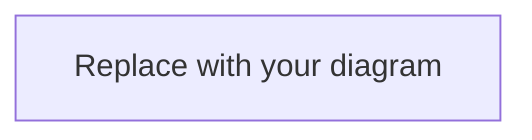

# Diagram: {{TITLE}}

**Date:** YYYY-MM-DD  
**Related:** Week {{WW}} Day {{DD}} · Section:  
**Type:** Architecture | Flow | Sequence | Whiteboard | Concept map  
**Tool:** Mermaid | Excalidraw | Other

---

## Purpose
What this diagram explains:

## Diagram

<!-- Or link/embed:  -->

## Components
| Component | Responsibility |
|---|---|
| | |

## Notes / trade-offs
-

## Interview talking points
1.
2.

## Promote to
- [ ] `04-diagrams/architecture/` or `flows/` or `whiteboard/`
- [ ] Linked from `08-revision/`
