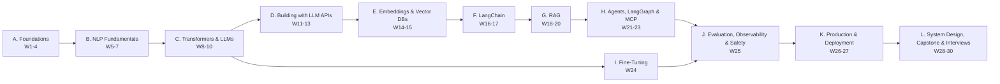

# Generative AI: Zero to Industry-Ready — Personal Roadmap

Primary source: company learning path (`Learning Content.xlsx`, 36 rows, 11 themes).
Every link below was verified as live on 12 Oct 2026 (YouTube titles/durations checked via YouTube itself).

---

## 1. How the program runs

| Item | Plan |
|---|---|
| Total duration | **30 weeks (~7 months)** + 2 optional buffer weeks |
| Weekly effort | ~10 h: Mon–Fri ≈ 1–1.5 h/day (Days 1–5), Sat ≈ 2.5–3 h (Day 6), Sun = rest / revision |
| Day 6 (Saturday) | Hands-on project work + **Weekly Test** |
| End of each section | **Mock interview** (one question at a time) |
| Architecture topics | **Whiteboard / system-design session** on [Excalidraw](https://excalidraw.com) (free, no login) — draw, export PNG, paste the image in chat. Mermaid text is also accepted. |
| Progression gate | Weekly test ≥ 70% to move on. 55–69% = move on with a revision list. < 55% = repeat weak days before moving on. |
| Tracking | `PROGRESS.md` + knowledge folders (`01-daily/`, `08-revision/`, …). See `README.md` and `00-meta/KNOWLEDGE_SYSTEM.md` |

### Scoring

**Weekly test (100):** Concepts 30 · Practical/Coding 25 · Scenario-based 20 · Problem-solving 15 · Interview questions 10

**Mock interview (100):** Conceptual understanding 15 · Technical depth 15 · Problem-solving 15 · Practical knowledge 15 · Communication 10 · Explaining concepts 10 · Real-world application 10 · Interview readiness 10

**System design (100):** Requirements & clarifying questions 10 · Core architecture/components 25 · Data & retrieval design 15 · Scalability 10 · Latency 10 · Security & privacy 10 · Cost 5 · Monitoring & evaluation 10 · Failure handling 5

### Status labels
`Not Started` → `In Progress` → `Needs Revision` → `Completed` → `Interview Ready`

---

## 2. Company learning path — analysis

| # | Company topic | Resource | Placed in | Notes |
|---|---|---|---|---|
| 1.1 | NLTK 0 (Preface) | [NLTK Book ch0](https://www.nltk.org/book/ch00.html) | W5 | OK |
| 1.2 | NLTK 1 (Language processing & Python) | [NLTK Book ch1](https://www.nltk.org/book/ch01.html) | W5 | OK |
| 2 | NLTK 3 (Processing raw text) | [NLTK Book ch3](https://www.nltk.org/book/ch03.html) | W5 | OK |
| 3 | NLTK 5 (Tagging words) | [NLTK Book ch5](https://www.nltk.org/book/ch05.html) | W6 | OK |
| 4.1 | BoW, TF-IDF, Word2Vec | Krish Naik Live NLP Day 2 | W6 | OK (1h56) |
| 4.2 | TF-IDF practical | Krish Naik Live NLP Day 3 | W6 | OK (1h15) |
| 5.1 | Word embedding, CBOW, Skip-gram | Krish Naik Live NLP Day 4 | W7 | OK (1h27) |
| 5.2 | Training Word2Vec, AvgWord2Vec | Krish Naik Day 5 | W7 | OK (1h01) |
| 6.1 / 6.1.1 | Transformers in depth + "Attention Is All You Need" | Krish Naik + [arXiv paper](https://arxiv.org/pdf/1706.03762) | W8 | OK |
| 6.2 | Attention (visually explained) | 3Blue1Brown ch6 | W8 | OK |
| 6.2.1 / 6.3 | Illustrated / Narrated Transformer | Jay Alammar blog + video | W8–W9 | OK |
| 6.4 | History of LLMs | CampusX | W10 | OK |
| 6.5 | Intro to LLMs | Andrej Karpathy | W10 | OK |
| 6.6 | Inside LLMs visually | 3Blue1Brown ch5 | W9 | OK |
| 7.1 | OpenAI Embeddings & Vector DB crash course | Adrian Twarog | W14 | OK |
| 7.2 / 7.3 | Word2Vec/CBOW, AvgWord2Vec (repeat of 5.x) | Krish Naik | W7 | **Duplicate of 5.1/5.2 — merged into W7** |
| 7.4 | OpenAI & Hugging Face embedding models | OpenAI docs, LangChain ref | W14 | Links redirect to new URLs (still fine) |
| 8.1 | OpenAI API — Chat Completions | Krish Naik | W11 | OK; supplemented with current API docs |
| 8.2 | Function calling | Krish Naik | W13 | OK |
| 8.3 | Coursera: LangChain Chat with your Data | Coursera | W17 | OK |
| 8.4 / 9.1–9.4 | LangChain intro, quickstart, cookbook 1 & 2 | Greg Kamradt, Rabbitmetrics | W16–W17 | **2023 videos — the concepts are still valid, but the code uses deprecated APIs (`LLMChain`, old imports). Watch for concepts; write code from current docs.** |
| 9.5 | GitHub guide for LangChain concepts | GitHub | W16 | **Broken (404).** Replacement: [LangChain docs](https://docs.langchain.com/oss/python/langchain/overview) |
| 10.1 | LangGraph course + guide | [LangChain Academy](https://academy.langchain.com) + [GitHub](https://github.com/langchain-ai/langchain-academy) | W21–W22 | Free signup needed |
| 11.1 / 11.2 | RAG from Scratch (videos + repo) | LangChain | W18–W19 | OK |
| 11.3 | Contextual RAG | Anthropic cookbook | W20 | **Broken (404).** Replacement: [claude-cookbooks guide](https://github.com/anthropics/claude-cookbooks/blob/main/capabilities/contextual-embeddings/guide.ipynb) + [Anthropic blog](https://www.anthropic.com/engineering/contextual-retrieval) |

### Ordering change
The company path puts LangChain and LangGraph (8–10) before RAG (11), and embeddings (7) between Transformers and APIs. I re-ordered by dependency:
**APIs → Prompting → Tool calling → Embeddings → Vector DBs → LangChain → RAG → Agents/LangGraph → MCP.** Agentic RAG needs RAG first, and RAG needs embeddings and vector DBs first.

### Topics missing from the company path (added)
Python & math prerequisites · ML fundamentals · Deep learning & PyTorch basics · RNN/LSTM (why Transformers exist) · Tokenization (BPE) · LLM training pipeline (pre-training → SFT → RLHF) · Decoding (temperature, top-p) · Multi-provider APIs (Azure OpenAI, Gemini, Claude) · **Prompt engineering** · Structured outputs · Vector DB internals (HNSW, IVF) and tools (FAISS, Chroma, Qdrant, pgvector) · Chunking · Hybrid search, reranking · RAG evaluation (RAGAS) · Agent theory (ReAct, workflows vs agents) · **MCP** · **Fine-tuning (LoRA/QLoRA/PEFT)** · **Evaluation & observability** · Guardrails & LLM security (OWASP) · FastAPI, Docker, cloud deployment · Caching, cost & latency · **GenAI system design** · Interview preparation.

---

## 3. Sections and dependencies

| Section | Weeks | Level | Mock interview | Whiteboard | Project |
|---|---|---|---|---|---|
| A. Foundations (Python, math, ML, DL) | 1–4 | Beginner | MI-1 (W4) | — | P0 Text analyzer CLI |
| B. NLP Fundamentals | 5–7 | Beginner | MI-2 (W7) | — | P1 Spam classifier · P2 Word2Vec similarity |
| C. Transformers & LLMs | 8–10 | Beginner→Intermediate | MI-3 (W10) | SD-1 "How ChatGPT answers a question" | — |
| D. Building with LLM APIs | 11–13 | Intermediate | MI-4 (W13) | SD-2 Customer-support chatbot | P3 CLI chatbot · P4 Tool-calling assistant |
| E. Embeddings & Vector DBs | 14–15 | Intermediate | (combined with F) | SD-3 AI semantic search | P5 Semantic search engine |
| F. LangChain | 16–17 | Intermediate | MI-5 (W17, E+F) | — | P6 LangChain doc-chat |
| G. RAG | 18–20 | Intermediate→Advanced | MI-6 (W20) | SD-4 Enterprise knowledge assistant | P7 PDF Q&A · P8 Enterprise RAG |
| H. Agents, LangGraph & MCP | 21–23 | Advanced | MI-7 (W23) | SD-5 Multi-agent + MCP platform | P9 Research agent · P10 MCP server |
| I. Fine-Tuning | 24 | Advanced | (combined with J) | — | P11 LoRA fine-tune |
| J. Eval, Observability, Safety | 25 | Advanced | MI-8 (W25, I+J) | SD-6 Eval & guardrails layer | P8 eval harness |
| K. Production & Deployment | 26–27 | Industry | (combined with L) | SD-7 Production GenAI platform | P12 Capstone build |
| L. System Design, Capstone, Interviews | 28–30 | Industry | **Final full mock (W30)** | SD-8 / SD-9 hard problems | P12 Capstone demo |

---

## 4. Week-by-week plan

Each day below lists the topic and the hands-on task. In every live lesson you also get: what to understand, theory, analogy, code walkthrough, practice questions, and the expected outcome.

---

### SECTION A — Foundations (Weeks 1–4)

#### Week 1 — The big picture + Python core  (~9 h)
**Objective:** Understand what GenAI is and where it sits in AI; get a working Python setup.
**Outcome:** You can explain AI vs ML vs DL vs GenAI vs LLM and write basic Python scripts that process text.

| Day | Topic & subtopics | Hands-on |
|---|---|---|
| 1 | AI → ML → DL → GenAI → LLM; what an LLM does (next-token prediction); GenAI use cases & limits; environment setup | Install Python 3.11+, VS Code/Cursor, venv; run first script; probe a chatbot for hallucinations |
| 2 | Python basics: variables, types, strings, string methods, f-strings | String-manipulation drills on sentences |
| 3 | Lists, dicts, sets, tuples; loops; comprehensions | Word-frequency counter |
| 4 | Functions, modules, `pip`, virtual envs, exceptions, file I/O | Read a `.txt` file and report stats |
| 5 | Classes & objects (just enough), type hints, reading other people's code | Refactor the counter into a `TextAnalyzer` class |
| 6 | **P0 Text analyzer CLI** + **Weekly Test 1** | |

**Resources:** [Google Cloud Tech — Introduction to Generative AI](https://www.youtube.com/watch?v=G2fqAlgmoPo) (22m) · [3Blue1Brown — Large Language Models explained briefly](https://www.youtube.com/watch?v=LPZh9BOjkQs) (8m) · [5 Minutes Engineering — What is Generative AI (Hindi)](https://www.youtube.com/watch?v=5l7Tw6UVQi8) (9m) · [CampusX — 100 Days of Python](https://www.youtube.com/playlist?list=PLKnIA16_Rmvb1RYR-iTA_hzckhdONtSW4) · [Krish Naik — Complete Python Playlist](https://www.youtube.com/playlist?list=PLZoTAELRMXVNUL99R4bDlVYsncUNvwUBB) · [freeCodeCamp — Learn Python Full Course](https://www.youtube.com/watch?v=rfscVS0vtbw) (4h27, reference)
**Interview focus:** "What is Generative AI?", "Discriminative vs generative models", "What is an LLM in one sentence?"

#### Week 2 — Python for AI + math intuition  (~10 h)
**Objective:** Learn the tools every GenAI codebase uses, plus the only math you need early on.
**Outcome:** You can call a REST API, handle JSON, use NumPy, and explain vectors, dot product and cosine similarity.

| Day | Topic & subtopics | Hands-on |
|---|---|---|
| 1 | JSON, HTTP, REST APIs, `requests`, status codes | Call a public API, parse JSON |
| 2 | Environment variables, `.env`, secrets hygiene, Git basics | Store a fake API key safely; first git commit |
| 3 | NumPy: arrays, shapes, broadcasting, matrix multiply | Matrix ops drills |
| 4 | Vectors, dot product, norms, **cosine similarity**; probability basics (distributions, softmax intuition) | Implement cosine similarity from scratch |
| 5 | pandas basics: DataFrame, filtering, groupby, CSV | Analyse a small text dataset |
| 6 | Mini task: "Similar sentences" with hand-made vectors + **Weekly Test 2** | |

**Resources:** [codebasics — numpy intro](https://www.youtube.com/watch?v=rN0TREj8G7U) (11m) · [codebasics — Pandas playlist](https://www.youtube.com/playlist?list=PLeo1K3hjS3uuASpe-1LjfG5f14Bnozjwy) · [3Blue1Brown — Essence of Linear Algebra](https://www.youtube.com/playlist?list=PLZHQObOWTQDPD3MizzM2xVFitgF8hE_ab) (ch1–3, 9) · [freeCodeCamp — Linear Algebra for ML](https://www.youtube.com/watch?v=QCPJ0VdpM00) (reference only)
**Interview focus:** "Why cosine similarity instead of Euclidean distance for text?"

#### Week 3 — Machine learning fundamentals  (~10 h)
**Objective:** Understand how machines "learn" from data.
**Outcome:** You can train and evaluate a scikit-learn model and explain loss, overfitting and gradient descent.

| Day | Topic & subtopics | Hands-on |
|---|---|---|
| 1 | What is ML; supervised / unsupervised / self-supervised (key for LLMs) | Classify example problems |
| 2 | Features, labels, train/val/test split, data leakage | Split a dataset correctly |
| 3 | Linear & logistic regression intuition; loss functions | scikit-learn logistic regression |
| 4 | Gradient descent; learning rate; overfitting vs underfitting; regularization | Plot loss vs learning rate |
| 5 | Metrics: accuracy, precision, recall, F1, confusion matrix | Evaluate your classifier |
| 6 | Mini task: Iris/Titanic classifier end-to-end + **Weekly Test 3** | |

**Resources:** [StatQuest — A Gentle Introduction to Machine Learning](https://www.youtube.com/watch?v=Gv9_4yMHFhI) (13m) · [CampusX — 100 Days of Machine Learning](https://www.youtube.com/playlist?list=PLKnIA16_Rmvbr7zKYQuBfsVkjoLcJgxHH) (selected videos) · [freeCodeCamp — Machine Learning for Everybody](https://www.youtube.com/watch?v=i_LwzRVP7bg) (3h54)
**Interview focus:** bias-variance, precision vs recall trade-offs, why LLM pre-training is "self-supervised".

#### Week 4 — Deep learning fundamentals  (~10 h)
**Objective:** Understand neural networks, enough to follow Transformers later.
**Outcome:** You can build a tiny network in PyTorch and explain backprop, softmax, cross-entropy, RNN/LSTM limits.

| Day | Topic & subtopics | Hands-on |
|---|---|---|
| 1 | Neuron, layers, activations (ReLU, sigmoid), forward pass | NumPy forward pass |
| 2 | Backpropagation & gradient descent intuition | Watch 3B1B ch2–3, draw the computation graph |
| 3 | PyTorch basics: tensors, autograd, `nn.Module`, training loop | Train a tiny MLP |
| 4 | Softmax, cross-entropy, embeddings layer, batching, GPU vs CPU | Inspect softmax outputs |
| 5 | Sequence models: RNN, LSTM, vanishing gradients → why attention | Concept map: RNN → LSTM → Attention |
| 6 | **Weekly Test 4** + **Mock Interview MI-1 (Foundations)** | |

**Resources:** [3Blue1Brown — Neural networks playlist](https://www.youtube.com/playlist?list=PLZHQObOWTQDNU6R1_67000Dx_ZCJB-3pi): [ch1](https://www.youtube.com/watch?v=aircAruvnKk) (~19m), [ch2 Gradient descent](https://www.youtube.com/watch?v=IHZwWFHWa-w) (21m), [ch3 Backprop](https://www.youtube.com/watch?v=Ilg3gGewQ5U) (13m) · [CampusX — Practical Deep Learning using PyTorch](https://www.youtube.com/playlist?list=PLKnIA16_Rmvboy8bmDCjwNHgTaYH2puK7) · [StatQuest — RNNs](https://www.youtube.com/watch?v=AsNTP8Kwu80) (17m) · [StatQuest — LSTM](https://www.youtube.com/watch?v=YCzL96nL7j0) (21m) · Optional deep dive: [Karpathy — micrograd](https://www.youtube.com/watch?v=VMj-3S1tku0) (2h26)

---

### SECTION B — NLP Fundamentals (Weeks 5–7)  ← company items 1–5, 7.2, 7.3

#### Week 5 — Text processing with NLTK  (~10 h)
**Objective:** Turn raw text into clean, structured tokens.
**Outcome:** You can tokenize, normalise, stem/lemmatize and analyse a corpus with NLTK and regex.

| Day | Topic & subtopics | Hands-on |
|---|---|---|
| 1 | NLTK ch0–ch1: corpora, concordance, frequency distributions | Explore `nltk.book` texts |
| 2 | ch1 cont.: lexical diversity, collocations, conditional frequency | Compare two texts |
| 3 | ch3: reading raw text, Unicode, regex for text | Regex extraction exercises |
| 4 | ch3: tokenization, stemming vs lemmatization, stopwords, normalization | Build a `clean_text()` pipeline |
| 5 | Word-level vs subword vs character tokens (preview of LLM tokenizers) | Compare tokenizers on tricky sentences |
| 6 | Mini task: corpus analysis report + **Weekly Test 5** | |

**Resources:** [NLTK ch0](https://www.nltk.org/book/ch00.html) · [ch1](https://www.nltk.org/book/ch01.html) · [ch3](https://www.nltk.org/book/ch03.html) · [Krish Naik — Live NLP Playlist](https://www.youtube.com/playlist?list=PLZoTAELRMXVNNrHSKv36Lr3_156yCo6Nn)

#### Week 6 — Tagging + classic text representations  (~10 h)
**Objective:** Represent text as numbers the classic way.
**Outcome:** You can build BoW and TF-IDF features and train a text classifier.

| Day | Topic & subtopics | Hands-on |
|---|---|---|
| 1 | NLTK ch5: POS tagging, tagsets, tagged corpora | Tag sentences, count noun/verb distribution |
| 2 | NER basics, n-grams | Extract entities from news text |
| 3 | One-hot, Bag of Words, n-gram BoW — pros/cons | `CountVectorizer` from scratch & sklearn |
| 4 | TF-IDF maths and intuition | TF-IDF by hand on 3 documents, verify with sklearn |
| 5 | TF-IDF practical: document similarity & keyword search | TF-IDF search over FAQs |
| 6 | **P1 SMS spam classifier** + **Weekly Test 6** | |

**Resources:** [NLTK ch5](https://www.nltk.org/book/ch05.html) · [Krish Naik — BoW, TF-IDF, Word2Vec](https://www.youtube.com/watch?v=VO6PeW6AePs&list=PLZoTAELRMXVNNrHSKv36Lr3_156yCo6Nn&index=4) (1h56) · [Krish Naik — TF-IDF Practical](https://www.youtube.com/watch?v=_gGRBWaRpAQ&list=PLZoTAELRMXVNNrHSKv36Lr3_156yCo6Nn&index=5) (1h15)

#### Week 7 — Word embeddings  (~10 h)
**Objective:** Move from counting words to learning meaning.
**Outcome:** You can explain CBOW vs Skip-gram, train Word2Vec with gensim, and explain why static embeddings fall short.

| Day | Topic & subtopics | Hands-on |
|---|---|---|
| 1 | Distributional hypothesis; dense vs sparse vectors | Illustrated Word2Vec reading |
| 2 | CBOW & Skip-gram, negative sampling | Draw both architectures |
| 3 | Train Word2Vec (gensim); analogies (king − man + woman) | Train on a small corpus |
| 4 | AvgWord2Vec for sentence vectors; classifier on top | Sentiment classifier with AvgWord2Vec |
| 5 | Limits: one vector per word ("bank"), OOV → contextual embeddings | Compare TF-IDF vs Word2Vec results |
| 6 | **P2 Word-similarity explorer** + **Weekly Test 7** + **MI-2 (NLP)** | |

**Resources:** [Krish Naik — Word Embedding, CBOW, Skip-gram](https://www.youtube.com/watch?v=hKgUlpcZ1eI&list=PLZoTAELRMXVNNrHSKv36Lr3_156yCo6Nn&index=6) (1h27) · [Krish Naik — Training Word2Vec, AvgWord2Vec](https://www.youtube.com/watch?v=g-Y5a4WDe7g&list=PLZoTAELRMXVNNrHSKv36Lr3_156yCo6Nn&index=7) (1h01) · [Krish Naik — Word2Vec & CBOW Part 1](https://www.youtube.com/watch?v=Q95SIG4g7SA) (48m) · [Krish Naik — AvgWord2Vec practical](https://www.youtube.com/watch?v=cyvkMFZnheo) (40m) · [StatQuest — Word Embedding & Word2Vec](https://www.youtube.com/watch?v=viZrOnJclY0) (16m) · [CampusX — Word2vec Complete Tutorial](https://www.youtube.com/watch?v=DDfLc5AHoJI) (1h16) · [Jay Alammar — Illustrated Word2vec](https://jalammar.github.io/illustrated-word2vec/)

---

### SECTION C — Transformers & LLMs (Weeks 8–10)  ← company items 6.x

#### Week 8 — Attention & the Transformer  (~11 h)
**Objective:** Understand the architecture behind every modern LLM.
**Outcome:** You can draw a Transformer and explain Q/K/V self-attention, multi-head attention, positional encoding.

| Day | Topic & subtopics | Hands-on |
|---|---|---|
| 1 | Seq2seq + the bottleneck problem → attention idea | StatQuest attention video |
| 2 | Self-attention: Query, Key, Value, scaled dot-product | Compute attention for 3 tokens by hand (NumPy) |
| 3 | Multi-head attention, positional encoding, residuals, LayerNorm, FFN | Annotate the Illustrated Transformer |
| 4 | Encoder–decoder; masking; read "Attention Is All You Need" (guided) | Paper-reading worksheet |
| 5 | Encoder-only (BERT) vs decoder-only (GPT) vs encoder-decoder (T5) | Comparison table |
| 6 | Implement self-attention in PyTorch + **Weekly Test 8** | |

**Resources:** [3Blue1Brown — Attention in transformers](https://www.youtube.com/watch?v=eMlx5fFNoYc) (26m) · [StatQuest — Attention](https://www.youtube.com/watch?v=PSs6nxngL6k) (16m) · [StatQuest — Transformer Neural Networks](https://www.youtube.com/watch?v=zxQyTK8quyY) (36m) · [Jay Alammar — Illustrated Transformer](https://jalammar.github.io/illustrated-transformer/) · [Krish Naik — Transformers In-depth](https://www.youtube.com/watch?v=SMZQrJ_L1vo&list=PLZoTAELRMXVNNrHSKv36Lr3_156yCo6Nn&index=14) (1h19) · [codebasics — Transformers Explained](https://www.youtube.com/watch?v=ZhAz268Hdpw) (58m) · [Paper](https://arxiv.org/pdf/1706.03762)

#### Week 9 — Inside an LLM  (~10 h)
**Objective:** Understand how a GPT-style model turns text into the next token.
**Outcome:** You can explain BPE tokenization, the logits → softmax → sampling flow, and run models from Hugging Face.

| Day | Topic & subtopics | Hands-on |
|---|---|---|
| 1 | Tokenization: BPE, vocab, why "strawberry" letter counting fails | `tiktoken` experiments |
| 2 | LLM forward pass visually: embeddings → blocks → logits | 3B1B ch5 + Narrated Transformer |
| 3 | Decoding: greedy, temperature, top-k, top-p, max tokens, stop sequences | Sample with different temperatures |
| 4 | Hugging Face: Hub, `pipeline`, `AutoTokenizer`, `AutoModel` | Run a small model locally |
| 5 | Context window, KV cache intuition, why long context is expensive | Measure token counts vs latency |
| 6 | Optional: Karpathy "Let's build GPT" (part 1) + **Weekly Test 9** | |

**Resources:** [3Blue1Brown — Transformers, the tech behind LLMs](https://www.youtube.com/watch?v=wjZofJX0v4M) (27m) · [Jay Alammar — Narrated Transformer](https://youtu.be/-QH8fRhqFHM) (29m) · [Karpathy — Let's build the GPT Tokenizer](https://www.youtube.com/watch?v=zduSFxRajkE) (2h14) · [Hugging Face — The pipeline function](https://www.youtube.com/watch?v=tiZFewofSLM) (5m) · [Hugging Face LLM Course](https://huggingface.co/learn/llm-course) · Advanced: [Karpathy — Let's build GPT](https://www.youtube.com/watch?v=kCc8FmEb1nY) (1h56)

#### Week 10 — The LLM landscape & how LLMs are trained  (~10 h)
**Objective:** Understand the full lifecycle and the industry landscape.
**Outcome:** You can explain pre-training → SFT → RLHF/DPO, hallucinations, and choose between models.

| Day | Topic & subtopics | Hands-on |
|---|---|---|
| 1 | History: RNN → LSTM → Transformer → BERT → GPT-1..4 → today | Timeline diagram |
| 2 | Pre-training: data, objective, scale, scaling laws | Karpathy Intro to LLMs (part 1) |
| 3 | Post-training: SFT, RLHF, DPO, reasoning models; base vs instruct | Compare a base vs instruct model |
| 4 | Hallucinations, knowledge cutoff, bias; when **not** to use an LLM | Hallucination test log |
| 5 | Model landscape: GPT/Azure OpenAI, Gemini, Claude, Llama/Mistral/Qwen; open vs closed; cost/latency/quality | Model-selection matrix |
| 6 | **Weekly Test 10** + **MI-3 (Transformers & LLMs)** + **SD-1 whiteboard (light): "What happens when you send a prompt to ChatGPT?"** | |

**Resources:** [CampusX — Epic History of LLMs](https://www.youtube.com/watch?v=8fX3rOjTloc) (1h27) · [Karpathy — Intro to Large Language Models](https://www.youtube.com/watch?v=zjkBMFhNj_g) (1h) · [Karpathy — Deep Dive into LLMs like ChatGPT](https://www.youtube.com/watch?v=7xTGNNLPyMI) (3h31, split over the week) · [Karpathy — How I use LLMs](https://www.youtube.com/watch?v=EWvNQjAaOHw) (2h11, optional)

---

### SECTION D — Building with LLM APIs (Weeks 11–13)  ← company 8.1, 8.2 + prompt engineering

#### Week 11 — LLM APIs  (~10 h)
**Objective:** Call LLMs from code reliably.
**Outcome:** You can build a multi-turn chatbot with streaming, token/cost tracking and error handling across providers.

| Day | Topic & subtopics | Hands-on |
|---|---|---|
| 1 | API keys, SDKs, Chat Completions vs Responses API; roles (system/user/assistant) | First API call |
| 2 | Parameters (temperature, max tokens), tokens & pricing, usage tracking | Cost calculator |
| 3 | Conversation memory (message history), context-window limits, truncation/summarization | Multi-turn CLI chat |
| 4 | Streaming, rate limits, retries with backoff, timeouts | Add streaming + retry |
| 5 | Provider abstraction: Azure OpenAI, Gemini, Claude, local (Ollama) | Swap providers behind one interface |
| 6 | **P3 CLI chatbot** + **Weekly Test 11** | |

**Resources:** [Krish Naik — OpenAI API Tutorial 1](https://www.youtube.com/watch?v=CbpsDMwFG2g&list=PLZoTAELRMXVMTWGW9iS45ZTcMsntos6VO) (37m; API shapes have changed — follow current docs) · [OpenAI API docs](https://developers.openai.com/api/docs) · [Patrick Loeber — Gemini API with Python](https://www.youtube.com/watch?v=qfWpPEgea2A) (12m) · [Microsoft — Generative AI for Beginners](https://github.com/microsoft/generative-ai-for-beginners)

#### Week 12 — Prompt engineering  (~10 h)  *(missing from company path)*
**Objective:** Get reliable, controllable outputs.
**Outcome:** You can write, test and version prompts, and get valid JSON every time.

| Day | Topic & subtopics | Hands-on |
|---|---|---|
| 1 | Anatomy of a prompt: instructions, context, examples, output format; delimiters | Rewrite 5 bad prompts |
| 2 | Zero-shot, few-shot, role prompting, chain-of-thought, self-consistency | Few-shot classifier |
| 3 | Structured outputs: JSON mode, schemas, Pydantic validation | Extract invoice fields to JSON |
| 4 | Prompt injection & jailbreaks (intro), system-prompt hygiene | Attack & defend your own bot |
| 5 | Prompt testing & versioning; small evaluation set | Prompt A/B test on 20 cases |
| 6 | Prompt-engineering challenge set + **Weekly Test 12** | |

**Resources:** [DeepLearning.AI — ChatGPT Prompt Engineering for Developers](https://www.deeplearning.ai/courses/chatgpt-prompt-eng) · [Anthropic — Interactive Prompt Engineering Tutorial](https://github.com/anthropics/prompt-eng-interactive-tutorial) · [Prompting Guide](https://www.promptingguide.ai) · [Krish Naik — Prompt Engineering & LLMs with LangChain](https://www.youtube.com/watch?v=t2bSApmPzU4) (17m) · [Krish Naik — Prompt Engineering vs RAG vs Fine-tuning](https://www.youtube.com/watch?v=6SO-8FcSkz4) (18m)

#### Week 13 — Function calling & tool use  (~10 h)
**Objective:** Let the LLM call your code.
**Outcome:** You can define tools with JSON schemas, run the tool loop, and handle errors and parallel calls.

| Day | Topic & subtopics | Hands-on |
|---|---|---|
| 1 | Why tools: LLMs can't act or fetch live data; tool-call lifecycle | Diagram the loop |
| 2 | Defining tool schemas; model chooses tool; you execute; return result | Weather + calculator tools |
| 3 | Multiple & parallel tool calls, `tool_choice`, validation | Add a SQLite "orders" tool |
| 4 | Error handling, safety (allow-lists, confirmation for destructive actions) | Harden the assistant |
| 5 | Tool use across providers (OpenAI, Gemini, Claude) | Port one tool to a second provider |
| 6 | **P4 Tool-calling assistant** + **Weekly Test 13** + **MI-4** + **SD-2 whiteboard: customer-support chatbot** | |

**Resources:** [Krish Naik — Function Calling with OpenAI](https://www.youtube.com/watch?v=zRdzLfoTwvQ&list=PLZoTAELRMXVMTWGW9iS45ZTcMsntos6VO&index=2) (18m) · [DeepLearning.AI — Functions, Tools and Agents with LangChain](https://www.deeplearning.ai/courses/functions-tools-agents-langchain)

---

### SECTION E — Embeddings & Vector Databases (Weeks 14–15)  ← company 7.1, 7.4

#### Week 14 — Modern embeddings & semantic search  (~10 h)
**Objective:** Represent sentences/documents by meaning.
**Outcome:** You can generate embeddings (OpenAI & Hugging Face) and build semantic search.

| Day | Topic & subtopics | Hands-on |
|---|---|---|
| 1 | Word2Vec → contextual → sentence embeddings; embedding models | Embed 20 sentences, inspect similarity |
| 2 | OpenAI embeddings: dimensions, cost, batching | Embed a FAQ set |
| 3 | Hugging Face / sentence-transformers embeddings (local, free) | Compare with OpenAI |
| 4 | Similarity metrics; normalization; brute-force search; MTEB leaderboard | NumPy semantic search |
| 5 | Keyword (BM25) vs semantic search; when each wins | Side-by-side comparison |
| 6 | **P5 Semantic search engine (part 1)** + **Weekly Test 14** | |

**Resources:** [Adrian Twarog — OpenAI Embeddings & Vector Databases Crash Course](https://www.youtube.com/watch?v=ySus5ZS0b94) (19m) · [OpenAI embeddings guide](https://developers.openai.com/api/docs/guides/embeddings) · [LangChain HuggingFace embeddings](https://reference.langchain.com/python/langchain-huggingface) · [IBM — What are Word Embeddings?](https://www.youtube.com/watch?v=wgfSDrqYMJ4) (9m)

#### Week 15 — Vector databases  (~10 h)
**Objective:** Store and search millions of vectors efficiently.
**Outcome:** You can explain ANN indexes and use FAISS, Chroma and pgvector/Qdrant with metadata filtering.

| Day | Topic & subtopics | Hands-on |
|---|---|---|
| 1 | Why vector DBs; exact vs approximate nearest neighbour | IBM + codebasics videos |
| 2 | Index types: Flat, IVF, HNSW, PQ; recall vs speed vs memory | FAISS benchmarks |
| 3 | Chroma: collections, metadata, filters, persistence | Port P5 to Chroma |
| 4 | Qdrant / Pinecone / PostgreSQL + pgvector; choosing a DB | pgvector or Qdrant in Docker |
| 5 | Multi-tenancy, updates/deletes, re-indexing, hybrid search preview | Design notes |
| 6 | **P5 finished** + **Weekly Test 15** + **SD-3 whiteboard: AI semantic search for an e-commerce catalogue** | |

**Resources:** [IBM — What is a Vector Database?](https://www.youtube.com/watch?v=gl1r1XV0SLw) (10m) · [codebasics — Vector Database Explained](https://www.youtube.com/watch?v=72XgD322wZ8) (7m)

---

### SECTION F — LangChain (Weeks 16–17)  ← company 8.3, 8.4, 9.x

> The company's LangChain videos (2023) are good for concepts, but their code is outdated. Learn concepts from them, write code from the [current LangChain docs](https://docs.langchain.com).

#### Week 16 — LangChain core  (~10 h)
**Objective:** Use a framework instead of hand-written glue.
**Outcome:** You can compose models, prompts, parsers and runnables (LCEL).

| Day | Topic & subtopics | Hands-on |
|---|---|---|
| 1 | Why frameworks; LangChain vs LangGraph vs LangSmith; ecosystem | Greg Kamradt overview + codebasics comparison |
| 2 | Chat models, prompt templates, messages | Rebuild P3 in LangChain |
| 3 | Output parsers & structured output | Pydantic extraction chain |
| 4 | LCEL / runnables: pipe, parallel, branching | Multi-step chain |
| 5 | Document loaders & text splitters | Load PDFs, web pages |
| 6 | Cookbook exercises + **Weekly Test 16** | |

**Resources:** [Greg Kamradt — What Is LangChain?](https://www.youtube.com/watch?v=_v_fgW2SkkQ) (6m) · [LangChain 101 Quickstart](https://www.youtube.com/watch?v=kYRB-vJFy38) (11m) · [Rabbitmetrics — LangChain in 13 Minutes](https://www.youtube.com/watch?v=aywZrzNaKjs) (13m) · [LangChain Cookbook Part 1](https://www.youtube.com/watch?v=2xxziIWmaSA) (38m) · [codebasics — LangChain Crash Course](https://www.youtube.com/watch?v=nAmC7SoVLd8) (46m) · [codebasics — LangChain vs LangGraph vs LangSmith](https://www.youtube.com/watch?v=vJOGC8QJZJQ) (10m) · [CampusX — Generative AI using LangChain](https://www.youtube.com/playlist?list=PLKnIA16_RmvaTbihpo4MtzVm4XOQa0ER0)

#### Week 17 — LangChain applications  (~10 h)
**Objective:** Build retrieval-backed apps and trace them.
**Outcome:** You can build a doc-chat with retrievers and chat history, and debug it with LangSmith.

| Day | Topic & subtopics | Hands-on |
|---|---|---|
| 1 | Vector stores & retrievers in LangChain | Chroma retriever |
| 2 | Chat history / memory patterns | History-aware chat |
| 3 | LangSmith tracing & debugging | Trace a failing chain |
| 4 | Coursera "Chat with your Data" project | Complete project |
| 5 | LlamaIndex overview: when it's a better fit | Same app in LlamaIndex (short) |
| 6 | **P6 LangChain doc-chat** + **Weekly Test 17** + **MI-5 (Embeddings, Vector DBs, LangChain)** | |

**Resources:** [LangChain Cookbook Part 2](https://www.youtube.com/watch?v=vGP4pQdCocw) (26m) · [Coursera — LangChain Chat with your Data](https://www.coursera.org/projects/langchain-chat-with-your-data-project) · [Greg Kamradt — LangChain playlist](https://www.youtube.com/playlist?list=PLqZXAkvF1bPNQER9mLmDbntNfSpzdDIU5) · [codebasics — LangChain playlist](https://www.youtube.com/playlist?list=PLeo1K3hjS3uu0N_0W6giDXzZIcB07Ng_F)

---

### SECTION G — Retrieval-Augmented Generation (Weeks 18–20)  ← company 11.x

#### Week 18 — RAG from scratch: the basics  (~11 h)
**Objective:** Ground LLM answers in your own documents.
**Outcome:** You can build an end-to-end RAG pipeline with citations.

| Day | Topic & subtopics | Hands-on |
|---|---|---|
| 1 | Why RAG; RAG vs fine-tuning vs long context | IBM RAG + RAG vs fine-tuning videos |
| 2 | Indexing: loading, cleaning, **chunking strategies** (fixed, recursive, semantic), overlap | Chunking experiments |
| 3 | Retrieval: top-k, similarity thresholds, metadata filters | Retrieval quality check |
| 4 | Generation: grounded prompts, citations, "I don't know" behaviour | Answer with sources |
| 5 | Pure-Python RAG (no framework) vs LangChain RAG | Build both |
| 6 | **P7 PDF Q&A** + **Weekly Test 18** | |

**Resources:** [LangChain — RAG From Scratch playlist](https://www.youtube.com/playlist?list=PLfaIDFEXuae2LXbO1_PKyVJiQ23ZztA0x) (parts 1–4) · [rag-from-scratch repo](https://github.com/langchain-ai/rag-from-scratch) · [IBM — What is RAG?](https://www.youtube.com/watch?v=T-D1OfcDW1M) (7m) · [codebasics — RAG Explained](https://www.youtube.com/watch?v=dDkynerzV-Q) (15m) · [IBM — RAG vs Fine Tuning](https://www.youtube.com/watch?v=00Q0G84kq3M) (9m) · [freeCodeCamp — Learn RAG From Scratch](https://www.youtube.com/watch?v=sVcwVQRHIc8) (2h33)

#### Week 19 — Advanced retrieval  (~11 h)
**Objective:** Fix the "retrieved the wrong chunks" problem.
**Outcome:** You can apply query transformation, hybrid search, reranking and routing.

| Day | Topic & subtopics | Hands-on |
|---|---|---|
| 1 | Query translation: multi-query, RAG-Fusion, decomposition, step-back, HyDE | Implement multi-query |
| 2 | Routing (logical/semantic), query construction (metadata filters from text) | Router over two indexes |
| 3 | Hybrid search: BM25 + dense, Reciprocal Rank Fusion | Hybrid retriever |
| 4 | Reranking with cross-encoders / rerank APIs | Measure before vs after |
| 5 | Indexing tricks: multi-vector, parent-document, RAPTOR, ColBERT (concepts) | Parent-doc retriever |
| 6 | Upgrade P7 + **Weekly Test 19** | |

**Resources:** RAG From Scratch parts 5–14 · [IBM — Sparse, Dense & Hybrid Retrieval](https://www.youtube.com/watch?v=r0Dciuq0knU) (8m) · [DeepLearning.AI — Building & Evaluating Advanced RAG](https://www.deeplearning.ai/courses/building-evaluating-advanced-rag)

#### Week 20 — Contextual RAG, evaluation & enterprise RAG  (~11 h)
**Objective:** Make RAG measurable and enterprise-grade.
**Outcome:** You can evaluate RAG with metrics, apply contextual retrieval, and design for permissions and freshness.

| Day | Topic & subtopics | Hands-on |
|---|---|---|
| 1 | Contextual retrieval (Anthropic): contextual embeddings + contextual BM25 | Walk through the cookbook |
| 2 | RAG evaluation: golden Q&A set, faithfulness, answer relevance, context precision/recall (RAGAS) | Build a 30-question eval set |
| 3 | Failure modes: missing context, bad chunking, lost-in-the-middle, stale data | Diagnose 5 broken cases |
| 4 | Enterprise concerns: access control (document-level ACLs), PII, incremental ingestion, multi-format docs | Design notes |
| 5 | Agentic RAG preview, GraphRAG (concept) | Read & summarize |
| 6 | **P8 Enterprise knowledge assistant** + **Weekly Test 20** + **MI-6 (RAG)** + **SD-4 whiteboard: enterprise knowledge assistant over 1M docs** | |

**Resources:** [Anthropic — Contextual Retrieval](https://www.anthropic.com/engineering/contextual-retrieval) · [claude-cookbooks — Contextual Embeddings guide](https://github.com/anthropics/claude-cookbooks/blob/main/capabilities/contextual-embeddings/guide.ipynb) · [RAGAS docs](https://docs.ragas.io)

---

### SECTION H — Agents, LangGraph & MCP (Weeks 21–23)  ← company 10.x + MCP

#### Week 21 — Agent fundamentals + LangGraph basics  (~11 h)
**Objective:** Understand when and how LLMs act autonomously.
**Outcome:** You can explain workflows vs agents and build a LangGraph agent with state, nodes and edges.

| Day | Topic & subtopics | Hands-on |
|---|---|---|
| 1 | GenAI vs Agentic AI; what an agent is; ReAct loop | IBM + CampusX videos |
| 2 | Anthropic patterns: prompt chaining, routing, parallelization, orchestrator-workers, evaluator-optimizer | Map each to a use case |
| 3 | LangGraph: state, nodes, edges, conditional edges | LangChain Academy module 1 |
| 4 | Tool-using agent in LangGraph; memory (short/long term) | ReAct agent with 3 tools |
| 5 | Agent failure modes: loops, wrong tool, cost blow-up; max-iterations, guards | Break & fix your agent |
| 6 | **Weekly Test 21** | |

**Resources:** [IBM — What are AI Agents?](https://www.youtube.com/watch?v=F8NKVhkZZWI) (12m) · [CampusX — Generative AI vs Agentic AI](https://www.youtube.com/watch?v=xdA0pGDiUPE) (1h03) · [CampusX — What is Agentic AI?](https://www.youtube.com/watch?v=GWnSsjT4V68) (1h) · [Anthropic — Building more effective AI agents](https://www.youtube.com/watch?v=uhJJgc-0iTQ) (19m) · [AI Engineer — How We Build Effective Agents (Barry Zhang, Anthropic)](https://www.youtube.com/watch?v=D7_ipDqhtwk) (15m) · [LangChain Academy](https://academy.langchain.com) + [repo](https://github.com/langchain-ai/langchain-academy) · [CampusX — Agentic AI using LangGraph](https://www.youtube.com/playlist?list=PLKnIA16_RmvYsvB8qkUQuJmJNuiCUJFPL)

#### Week 22 — Advanced LangGraph & multi-agent systems  (~11 h)
**Objective:** Build reliable, controllable agent systems.
**Outcome:** You can add persistence, human-in-the-loop, and supervisor-style multi-agent designs.

| Day | Topic & subtopics | Hands-on |
|---|---|---|
| 1 | Persistence & checkpointers; threads | Resume a conversation |
| 2 | Human-in-the-loop: interrupts, approvals, editing state | Approval before "send email" |
| 3 | Multi-agent: supervisor, hierarchical, network; handoffs | Researcher + writer agents |
| 4 | Agentic RAG (retrieve → grade → rewrite → answer) | Self-correcting RAG |
| 5 | Streaming, debugging with LangSmith; cost control | Trace & optimize |
| 6 | **P9 Multi-agent research assistant** + **Weekly Test 22** | |

**Resources:** LangChain Academy modules 2–5 · [DeepLearning.AI — AI Agents in LangGraph](https://www.deeplearning.ai/courses/ai-agents-in-langgraph) · [Hugging Face Agents Course](https://huggingface.co/learn/agents-course) · [Microsoft — AI Agents for Beginners](https://github.com/microsoft/ai-agents-for-beginners)

#### Week 23 — Model Context Protocol (MCP)  (~10 h)  *(missing from company path)*
**Objective:** Connect LLM apps to tools and data through a standard protocol.
**Outcome:** You can build an MCP server, connect it to a client, and explain MCP vs function calling vs APIs.

| Day | Topic & subtopics | Hands-on |
|---|---|---|
| 1 | Why MCP; host / client / server; MCP vs API vs function calling | IBM + codebasics videos |
| 2 | Primitives: tools, resources, prompts; transports (stdio, streamable HTTP) | Read spec intro |
| 3 | Build an MCP server with the Python SDK | Notes/DB MCP server |
| 4 | Connect to clients (Cursor, Claude Desktop) and to a LangGraph agent | Agent using your MCP server |
| 5 | MCP security: auth, least privilege, tool poisoning, prompt injection via tools | Threat-model your server |
| 6 | **P10 MCP server** + **Weekly Test 23** + **MI-7 (Agents & MCP)** + **SD-5 whiteboard: multi-agent + MCP enterprise platform** | |

**Resources:** [modelcontextprotocol.io](https://modelcontextprotocol.io) · [IBM — What is MCP?](https://www.youtube.com/watch?v=eur8dUO9mvE) (4m) · [IBM — MCP vs API](https://www.youtube.com/watch?v=7j1t3UZA1TY) (13m) · [codebasics — MCP Clearly Explained](https://www.youtube.com/watch?v=tzrwxLNHtRY) (15m) · [Krish Naik — All About MCP](https://www.youtube.com/watch?v=-UQ6OZywZ2I) (25m) · [Krish Naik — MCP Crash Course with Python](https://www.youtube.com/watch?v=MDBG2MOp4Go) (55m) · [CampusX — MCP playlist](https://www.youtube.com/playlist?list=PLKnIA16_Rmva_oZ9F4ayUu9qcWgF7Fyc0) · [DeepLearning.AI — MCP with Anthropic](https://www.deeplearning.ai/courses/mcp-build-rich-context-ai-apps-with-anthropic) · [Microsoft — MCP for Beginners](https://github.com/microsoft/mcp-for-beginners)

---

### SECTION I — Fine-Tuning (Week 24)  *(missing from company path)*

#### Week 24 — Fine-tuning with LoRA / QLoRA  (~11 h)
**Objective:** Know when fine-tuning is the right tool and how to do it cheaply.
**Outcome:** You can fine-tune a small open model with LoRA on Colab and compare it with prompting/RAG.

| Day | Topic & subtopics | Hands-on |
|---|---|---|
| 1 | Prompting vs RAG vs fine-tuning decision framework; full FT vs PEFT | Decision table for 6 scenarios |
| 2 | Quantization (8-bit/4-bit), LoRA & QLoRA intuition and maths | Krish Naik parts 1–2 |
| 3 | Dataset preparation: instruction format, chat templates, quality > quantity | Build a 300-example dataset |
| 4 | Train with Hugging Face PEFT / Unsloth on Colab | Fine-tune a 1–3B model |
| 5 | Evaluate vs base model; DPO/preference tuning (concept); serving adapters | Before/after eval |
| 6 | **P11 LoRA fine-tune** + **Weekly Test 24** | |

**Resources:** [Krish Naik — Part 1: Quantization, LoRA, QLoRA](https://www.youtube.com/watch?v=6S59Y0ckTm4) (33m) · [Krish Naik — Part 2: LoRA/QLoRA maths](https://www.youtube.com/watch?v=l5a_uKnbEr4) (23m) · [Krish Naik — Finetuning LLM playlist](https://www.youtube.com/playlist?list=PLZoTAELRMXVN9VbAx5I2VvloTtYmlApe3) · [freeCodeCamp — Fine Tuning LLM Models](https://www.youtube.com/watch?v=iOdFUJiB0Zc) (2h37) · [IBM — Is Fine-Tuning Still Needed?](https://www.youtube.com/watch?v=-W2JdSl1v48) (11m) · [DeepLearning.AI — Finetuning LLMs](https://www.deeplearning.ai/courses/finetuning-large-language-models) · [HF PEFT docs](https://huggingface.co/docs/peft) · [Unsloth docs](https://unsloth.ai/docs)

---

### SECTION J — Evaluation, Observability & Safety (Week 25)  *(missing from company path)*

#### Week 25 — Evals, observability, guardrails  (~11 h)
**Objective:** Prove your system works and keep it safe.
**Outcome:** You can build an eval harness, use LLM-as-judge correctly, trace production calls, and defend against OWASP LLM risks.

| Day | Topic & subtopics | Hands-on |
|---|---|---|
| 1 | Eval strategy: error analysis first, golden sets, offline vs online evals | Error-analysis on P8 |
| 2 | LLM-as-judge: rubrics, biases, calibration with human labels | Judge for P8 answers |
| 3 | Observability: traces, spans, latency, tokens, cost (LangSmith / Langfuse) | Instrument P8 |
| 4 | Guardrails: input/output validation, PII redaction, topic restriction, moderation | Add guardrails layer |
| 5 | OWASP Top 10 for LLMs: prompt injection, data leakage, excessive agency | Red-team your apps |
| 6 | **Weekly Test 25** + **MI-8 (Fine-tuning, Eval, Safety)** + **SD-6 whiteboard: evaluation & guardrails layer for a bank chatbot** | |

**Resources:** [Hamel Husain — Your AI Product Needs Evals](https://hamel.dev/blog/posts/evals/) · [IBM — LLM as a Judge](https://www.youtube.com/watch?v=trfUBIDeI1Y) (6m) · [IBM — LLM Hacking Defense](https://www.youtube.com/watch?v=y8iDGA4Y650) (14m) · [OWASP Top 10 for LLM Apps](https://genai.owasp.org/llm-top-10/) · [Langfuse docs](https://langfuse.com/docs) · [RAGAS](https://docs.ragas.io)

---

### SECTION K — Production & Deployment (Weeks 26–27)  *(missing from company path)*

#### Week 26 — Serving GenAI apps  (~11 h)
**Objective:** Turn notebooks into services.
**Outcome:** You can expose an LLM app as a FastAPI service with streaming, run it in Docker, and control cost/latency.

| Day | Topic & subtopics | Hands-on |
|---|---|---|
| 1 | FastAPI basics: routes, Pydantic models, async | Wrap P8 in an API |
| 2 | Streaming responses (SSE), background tasks, long-running jobs | Streaming endpoint |
| 3 | Docker: images, containers, Dockerfile, docker-compose (app + vector DB) | Containerize P8 |
| 4 | Caching (exact, semantic, provider prompt caching), batching, model routing for cost | Add a cache, measure |
| 5 | Reliability: retries, fallbacks across providers, timeouts, rate limiting, config & secrets | Fallback provider |
| 6 | **Capstone P12 kickoff** + **Weekly Test 26** | |

**Resources:** [CampusX — FastAPI for Machine Learning](https://www.youtube.com/playlist?list=PLKnIA16_RmvZ41tjbKB2ZnwchfniNsMuQ) · [codebasics — FastAPI Tutorial](https://www.youtube.com/watch?v=Wr1JjhTt1Xg) (16m) · [FastAPI docs](https://fastapi.tiangolo.com/tutorial/) · [TechWorld with Nana — Docker Tutorial](https://www.youtube.com/watch?v=3c-iBn73dDE) (2h46) · [IBM — What is Prompt Caching?](https://www.youtube.com/watch?v=u57EnkQaUTY) (9m)

#### Week 27 — Cloud deployment & LLMOps  (~11 h)
**Objective:** Deploy and operate in the cloud.
**Outcome:** You can deploy a containerized GenAI app (Azure or AWS), with CI/CD, monitoring and prompt management.

| Day | Topic & subtopics | Hands-on |
|---|---|---|
| 1 | Cloud options: Azure OpenAI + Container Apps / AWS Bedrock + Lambda/ECS / GCP Vertex | Pick your company's stack |
| 2 | Deploy the container; managed vector DB; secrets manager | Deploy P12 |
| 3 | CI/CD with GitHub Actions; eval gates in CI | Pipeline that runs evals |
| 4 | Prompt management & versioning; feature flags; A/B tests | Version prompts |
| 5 | Production monitoring: dashboards, alerts, drift, feedback loops | Monitoring dashboard |
| 6 | **Capstone build** + **Weekly Test 27** + **SD-7 whiteboard: production GenAI platform for 10k employees** | |

**Resources:** [Krish Naik — End-to-End GenAI Project on AWS Bedrock](https://www.youtube.com/watch?v=3OP39y4dO_Y) (55m) · Microsoft Generative AI for Beginners (deployment lessons)

---

### SECTION L — System Design, Capstone & Interview Prep (Weeks 28–30)

#### Week 28 — GenAI system design
| Day | Topic | Hands-on |
|---|---|---|
| 1 | System-design framework: requirements → API → data → model → retrieval → orchestration → eval → ops | Template |
| 2 | Latency & throughput: token budgets, streaming, caching, smaller models, parallel calls | Latency budget exercise |
| 3 | Cost modelling: tokens × traffic, model routing, self-host vs API | Cost sheet |
| 4 | Security & compliance: data residency, PII, tenant isolation, audit logs | Threat model |
| 5 | Practice: SD-8 whiteboard (AI search across 50M docs, multi-tenant) | Whiteboard |
| 6 | **Weekly Test 28** + SD-9 whiteboard (agentic customer-ops platform with MCP) | |

#### Week 29 — Capstone completion
Finish, test, deploy and document P12. Day 6: **capstone demo + project-deep-dive interview**.

#### Week 30 — Final interview preparation
| Day | Activity |
|---|---|
| 1 | Revision: weak areas from `PROGRESS.md` |
| 2 | Rapid-fire Q&A (100 questions across syllabus) |
| 3 | Coding round: build a RAG/tool feature live in 60 min |
| 4 | System-design round (full 45-min mock) |
| 5 | Behavioural + project storytelling (STAR) |
| 6 | **FINAL full GenAI mock interview** + readiness report |

**Resources:** [codebasics — Gen AI Roadmap](https://www.youtube.com/watch?v=YVBeVM_fA4k) (1h) · [5 Minutes Engineering — 25 Most Asked GenAI Interview Questions (Hindi)](https://www.youtube.com/watch?v=iQ6sGS7P3zY) (1h01)

---

## 5. Hands-on projects

| # | Project | Week | Problem | Key tech | Done when… |
|---|---|---|---|---|---|
| P0 | Text analyzer CLI | 1 | Report stats for any text file | Python | Word/sentence counts, top words, tests pass |
| P1 | SMS spam classifier | 6 | Flag spam messages | NLTK, scikit-learn, TF-IDF | F1 ≥ 0.9 on test set, confusion matrix explained |
| P2 | Word-similarity explorer | 7 | Find similar words / analogies | gensim Word2Vec | Analogies work; you can explain the failures |
| P3 | CLI chatbot | 11 | Multi-turn chat with memory | LLM API, streaming | History, token/cost display, retries, provider switch |
| P4 | Tool-calling assistant | 13 | Answer questions using live tools | Function calling, SQLite | Correct tool choice on 15 test prompts; safe failure |
| P5 | Semantic search engine | 14–15 | Search FAQs/products by meaning | Embeddings, FAISS/Chroma/pgvector | Beats BM25 on a 20-query test set |
| P6 | LangChain doc-chat | 17 | Chat with a docs folder | LangChain, LCEL, LangSmith | Traced, history-aware answers |
| P7 | PDF Q&A | 18–19 | Answer questions from PDFs with citations | RAG, hybrid search, reranker | Cites pages; says "don't know" when unsupported |
| P8 | Enterprise knowledge assistant | 20, 25, 26 | Company knowledge bot with permissions | RAG, contextual retrieval, RAGAS, ACL filters, guardrails | Eval set ≥ 85% faithfulness; ACLs enforced; API + Docker |
| P9 | Multi-agent research assistant | 22 | Research a topic and write a cited report | LangGraph, supervisor pattern, HITL | Produces report; human approves before final |
| P10 | MCP server | 23 | Expose company data/tools to any AI client | MCP Python SDK | Works in Cursor/Claude Desktop and in your agent |
| P11 | LoRA fine-tune | 24 | Teach a small model a format/style/task | HF PEFT / Unsloth, Colab | Measurable gain over base model on held-out set |
| P12 | **Capstone: production GenAI app** | 26–29 | Your choice (default: internal "AI help desk" combining RAG + tools + MCP + agent) | FastAPI, Docker, cloud, evals, observability, guardrails | Deployed, monitored, eval-gated CI, demo + design doc |

For each project, the full brief (problem statement, requirements, architecture, technologies, development steps, expected output, testing requirements, interview questions) is given on the day the project starts.

---

## 6. System-design / whiteboard ladder

| # | Week | Problem | Difficulty |
|---|---|---|---|
| SD-1 | 10 | What happens end-to-end when you send a prompt to ChatGPT? | ★ |
| SD-2 | 13 | Customer-support chatbot with order-lookup tools | ★★ |
| SD-3 | 15 | Semantic product search for an e-commerce catalogue (5M items) | ★★ |
| SD-4 | 20 | Enterprise knowledge assistant over 1M documents with access control | ★★★ |
| SD-5 | 23 | Multi-agent + MCP platform for internal operations | ★★★★ |
| SD-6 | 25 | Evaluation & guardrails layer for a bank's chatbot | ★★★★ |
| SD-7 | 27 | Production GenAI platform for 10k employees (multi-model gateway) | ★★★★ |
| SD-8 | 28 | Multi-tenant AI search across 50M documents | ★★★★★ |
| SD-9 | 28 | Agentic customer-operations platform (tools, MCP, HITL, SLAs) | ★★★★★ |

Each session: problem → you draw (Excalidraw / Mermaid) → follow-up questions → evaluation of missing components, scalability, latency, security, cost, monitoring/eval, failure scenarios → score /100.

---

## 7. Interview preparation (running thread)

After every important topic: basic / intermediate / advanced / scenario / practical questions + common mistakes. Mock interviews MI-1 … MI-8 at section ends, plus the **final full mock** in Week 30. Questions are asked one at a time; answers are revealed only after you respond.
